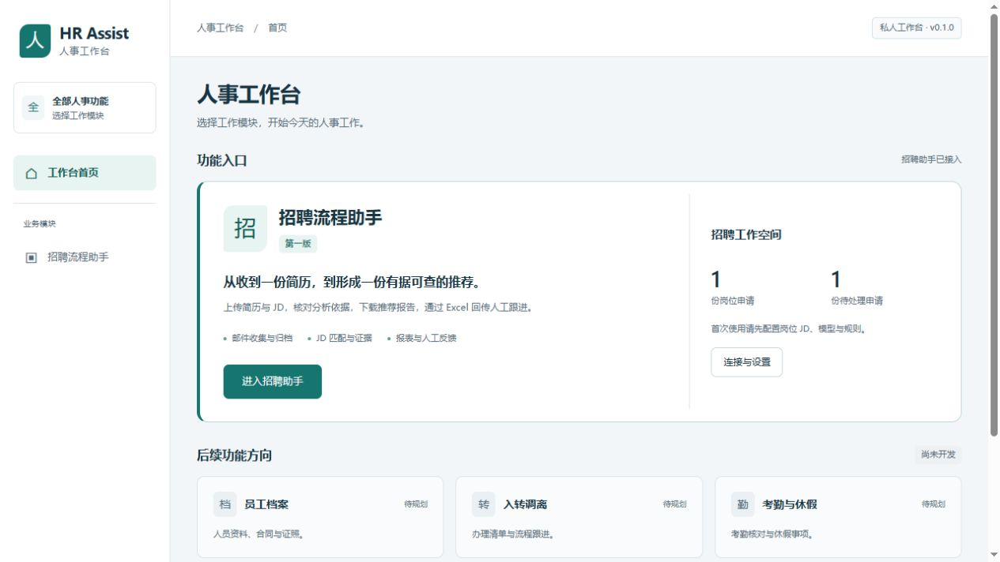
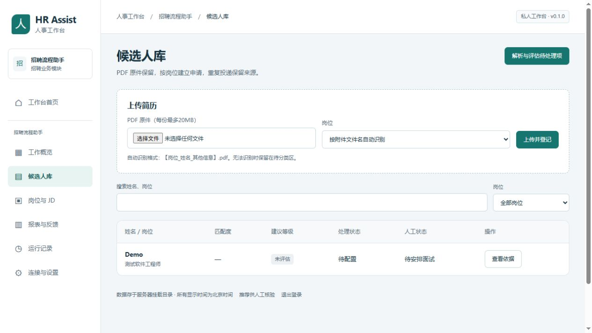

# 第一版实施与验收 · 0.1.0

日期：2026-10-23。针对真实服务 `hr_assist/`；`prototype/` 为历史演示。

## 实施决定

- 群晖 x86_64 单容器，反向代理 HTTPS，单用户账号。
- 人事功能选择首页；第一期实现招聘模块。
- 人工表与自动总览分离，网页下载、Excel编辑、回传，避免互联网 SMB。
- 本地解析、日志、哈希、分数；获批模型仅接收去标识化文字和岗位要求。
- 反馈统计 → 用户修改评分细则 → 新JD版本 → 显式重评；不自动训练或调权。

## 检查范围

测试使用合成 PDF、JD、临时 SQLite 和真实 `.xlsx`。邮箱、模型为测试替身，不访问生产账户；不代表真实推荐准确率。

| 范围 | 验证内容 |
| --- | --- |
| 登录 | 未登录拒绝、中文账号、CSRF、跨来源写入拒绝、凭据不回显/不存明文 |
| 岗位/原件 | JD缺失、版本保留、真实PDF解析、去重、哈希一致、路径边界、加密PDF隔离 |
| 工作流 | 全批解析后评估、缺配置暂停、缓存重用、失败不推进游标、续跑不重复 |
| 评分 | 固定分值、门槛封顶、未知待定、伪造引文/事实拒绝、OCR待核验、脱敏、人工核验后缓存失效 |
| Excel | 日期/公式、旧表非冲突合并、冲突整批回滚、清空单元格、遗漏行保留、ID篡改拒绝、机器文本公式注入防护 |
| IMAP | 精确时间窗口、迟出现UID、AND/OR、BODY.PEEK、MIME解码 |
| 部署 | Compose配置、单实例锁；CI镜像构建、容器登录、扫描PDF OCR、重启持久化 |

## 实测记录

- Windows / Python 3.10：21项自动测试通过；JavaScript语法检查通过；Compose配置解析通过。Starlette提示未来迁移测试客户端的弃用警告，无测试失败。
- 浏览器真实服务：登录 → 功能选择 → 创建岗位 → 上传合成PDF → 解析归档 → 缺模型明确暂停 → 下载人工表 → 编辑后回传 → 候选人显示人工状态，已完成验证。未接入真实云模型。
- 首轮 Linux / Python 3.12 CI：18项测试、Docker构建、非root只读容器登录、中英文OCR引擎与扫描PDF实际识别、重启后登录通过。[运行记录](https://github.com/wyf518www/HR_Assist/actions/runs/39916502378)，源码提交 `9823f63`。
- 后续补充的边界检查包括请求体实际字节上限、模型接口契约与错误脱敏、全日制不自动推断为统招，以及更明确的数据库持久化检查。最终提交以 GitHub Actions 对应提交状态为准。

自动检查入口：`.github/workflows/ci.yml`、`scripts/container_smoke.py`。

## 当前边界

- 未连接用户 NAS，尚未完成群晖实机、反向代理证书、外网和真实09:00验收。
- QQ授权码、获批模型地址/密钥、真实业务样本未提供，真实连接、JSON兼容性与推荐质量需部署后验证。
- 通知仅在工作台内；手机、邮件、企业微信推送未实现。
- 单文件20MB、PDF最多40页、100000字符、解析总超时180秒；模型失败人工续跑，无自动多次调用重试。
- 解析子进程有超时和 Linux 内存/CPU/文件大小限制，但不是独立禁网沙箱。
- 引文逐字核验不证明语义结论正确。保留校验后判定、引用、版本、使用量；未长期保存模型非结构化全文。
- 单容器单worker，不支持多实例；SQLite必须位于 NAS 本机目录，不放网络共享。
- 历史设计中的 Windows 凭据管理、原位更新同一 Excel、自动反馈校准和桌面通知，不属于当前实现。
